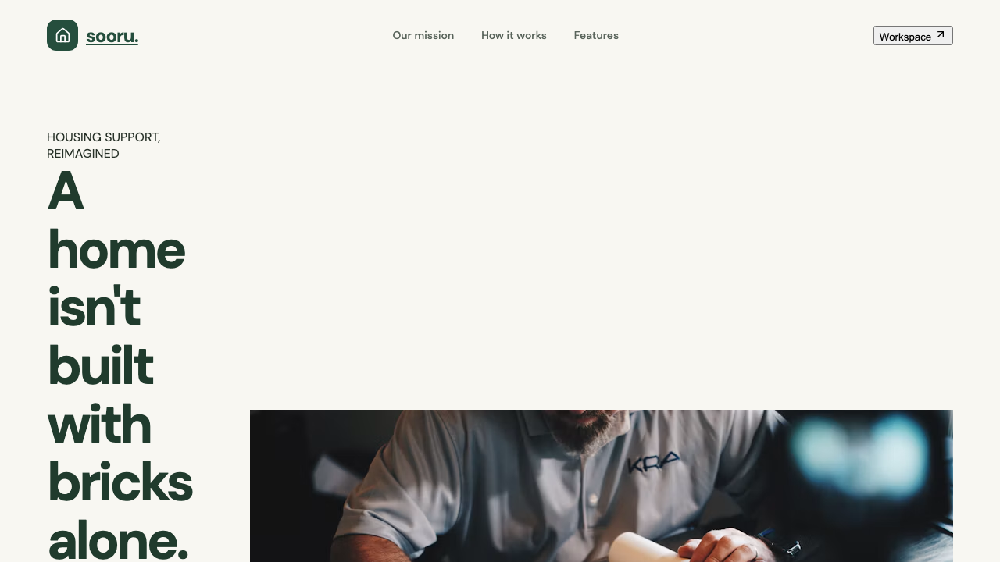
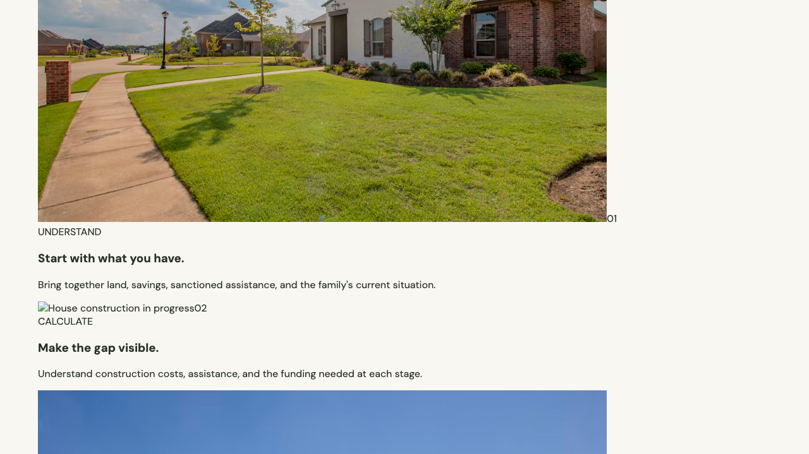
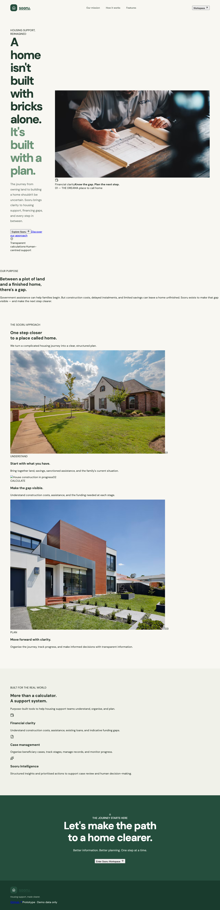

<div align="center">


# Sooru (ಸೂರು)

### Housing Support Case Management

**Lend the gap, not the house.**

A case-management platform designed to help housing support teams track beneficiaries, monitor construction progress, record consent, and understand indicative financing gaps.

<br/>


</div>

---

## Overview

For many rural families, receiving housing assistance is only one step toward building a home. Construction can stall when funding is insufficient, financial information is fragmented, or the next stage of support requires additional coordination.

**Sooru** is a housing-support case management prototype that provides a centralized workspace for tracking beneficiary cases, construction progress, sanctioned assistance, and indicative financing gaps.

The platform brings beneficiary records, case stages, financial information, consent records, and activity logs together in a single dashboard.

> Built around the idea that housing support should be transparent, coordinated, and centered on the beneficiary.

---

## Screenshots

### Landing Page



### Dashboard & Case Management



### Full Application



---

## Demo

🎥 **Application walkthrough:** [Watch the demo recording](captures/demo.webm)

🌐 **Hosted demo:** [sooru-jmae.vercel.app](https://sooru-jmae.vercel.app)

> The hosted deployment may not reflect the latest code in this repository. The local Docker setup runs the current version.

---

## Key Features

### 📊 Housing Support Dashboard
- Total beneficiary overview
- Active case tracking
- Estimated financing gap across cases
- Case completion rate
- Construction-stage distribution

### 👥 Beneficiary Management
- Create and manage beneficiary records
- Track beneficiary location by village and taluk
- Store limited contact information
- Search cases by beneficiary, location, or status
- Update beneficiary case information
- Delete case records

### 🏗️ Case Pipeline

Track cases throughout the housing support journey:

`Intake → Verified → Planning → Finance Review → Construction → Completed`

- Visual status distribution
- Case-level progress tracking
- Centralized beneficiary records

### 💰 Indicative Financing Gap

The prototype calculates an indicative gap using confirmed sanctioned funding:

\[
\text{Financing Gap} =
\max(0,\text{Estimated Construction Cost}-\text{Sanctioned Funding})
\]

Existing loans are recorded separately and are not automatically treated as available funding.

### 📝 Consent Records

- Record consent associated with case processing
- Maintain consent history
- Track consent status
- Store consent scope and text-version metadata

### 📋 Audit Trail

- Track case creation
- Track case updates
- Track case deletion
- Record consent events
- Review activity logs through the API

---

## Architecture

Sooru follows a frontend–backend architecture with a persistent PostgreSQL database.

```mermaid
flowchart TD
    U[User] --> F[React Frontend]
    F --> A[FastAPI REST API]
    A --> D[(PostgreSQL)]
    A --> C[Case Management]
    A --> G[Financing Gap Calculation]
    A --> S[Consent Records]
    A --> L[Audit Logs]
head -40 README.md


