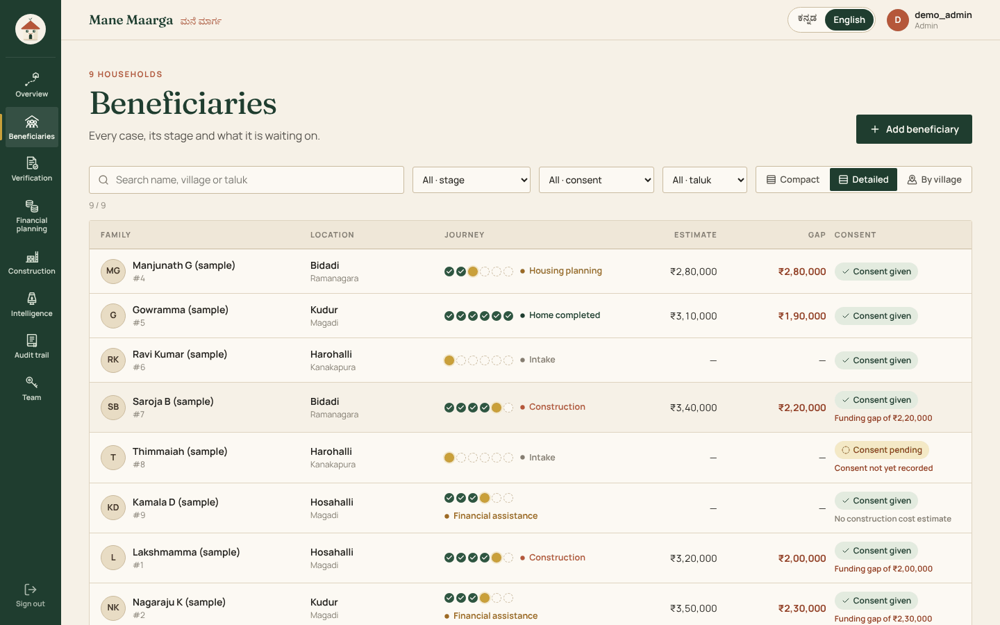
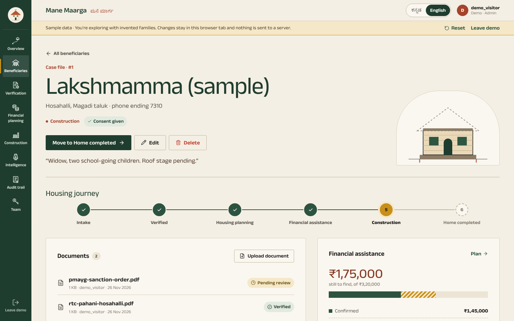
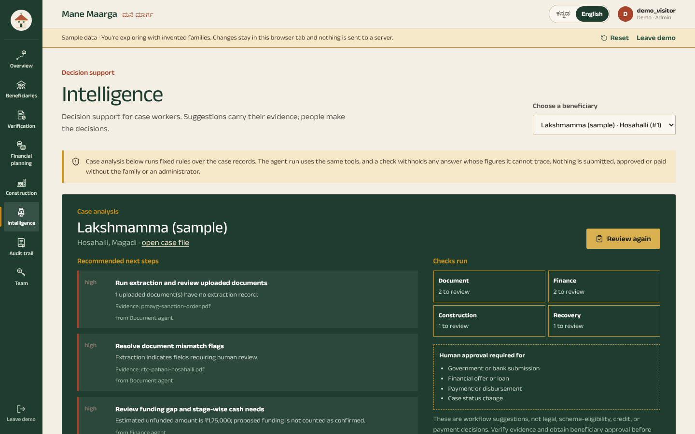
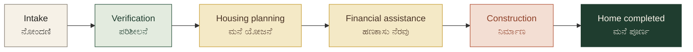
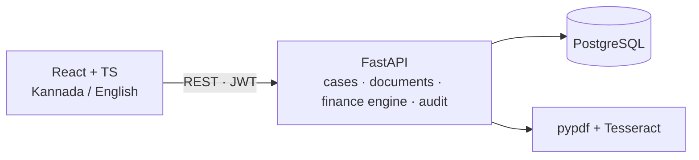

<div align="center">


# Mane Maarga · ಮನೆ ಮಾರ್ಗ

**A pathway to a home. A platform for dignity.**

<sub>ಮನೆಗೆ ದಾರಿ, ಬದುಕಿಗೆ ಭರವಸೆ — <i>the path to a home, hope for a better life</i></sub>

Mane Maarga helps case workers take rural families in Karnataka from their first housing-assistance record to their front door, keeping documents, money and construction stages in one record that anyone can check.


<p>


</p>

[Live preview](https://mane-maarga.vercel.app) · [Run it locally](#run-it-locally) · [Screenshots](#screenshots) · [Responsible AI](#responsible-ai)

</div>

---

## Live demo

- **Live preview:** open [mane-maarga.vercel.app](https://mane-maarga.vercel.app), choose **Access the platform**, then **Explore with sample data**. No server is needed: a clearly labelled demo mode runs the workspace in your browser with invented “(sample)” families, using the same rules as the API (money ladder, 30% cap, no double counting). Nothing leaves the browser tab.
- **Full stack:** to sign in against the real API with document text extraction, [run it locally](#run-it-locally).
- **What to explore:** add a family → upload a land record → compare the extracted fields with the case → check the money ladder → review the case insights.

<div align="center">

<br /><sub>Recorded from the running app with synthetic records. Every name is marked “(sample)”.</sub>
</div>

## Why it exists

> Mane Maarga brings the housing-assistance journey into one transparent workflow, from identifying a beneficiary and verifying documents to financial planning, construction progress and completion.
>
> It's designed for rural accessibility and accountability. Administrators make better-informed decisions, and the family stays at the centre of the process.

Under PMAY-G, a family in the plains receives ₹1.20 lakh, released in instalments after each construction stage is verified. The bills come due before the instalment arrives, and that timing gap is where families stall. Mane Maarga shows the gap stage by stage. It keeps confirmed, proposed and estimated money separate, so none of it is counted twice.

## Screenshots

<table>
<tr>
<td width="50%"><br /><sub><b>Overview</b> · every family on the journey, plus what needs a decision today</sub></td>
<td width="50%"><br /><sub><b>Beneficiaries</b> · search, filters, and compact, detailed or village views</sub></td>
</tr>
<tr>
<td width="50%"><br /><sub><b>Case file</b> · the family's whole housing journey on one page</sub></td>
<td width="50%"><br /><sub><b>Verification desk</b> · extraction suggests, the reviewer decides</sub></td>
</tr>
<tr>
<td width="50%"><br /><sub><b>Financial planning</b> · confirmed vs proposed money, and the money ladder</sub></td>
<td width="50%"><br /><sub><b>Intelligence</b> · suggestions with evidence; a person approves every decision</sub></td>
</tr>
</table>

## What works today

| Area | What is built |
|---|---|
| **Beneficiary management** | Case records with village, taluk and phone (last four digits only), a six-stage journey, consent capture and withdrawal, search, filters and village grouping. |
| **Document verification** | PDF/PNG/JPEG upload (10 MB, file signatures checked), authenticated preview, text extraction with `pypdf` and Tesseract (English + Kannada), field-by-field comparison with the case, and a verify / reject / request-correction decision. |
| **Scheme-aware finance** | Funding sources marked proposed, confirmed, received or rejected. Duplicate confirmed scheme references are blocked. A dated PMAY-G Karnataka rule pack drives the **money ladder**, and a **30% repayment cap** counts every existing loan, including the PMAY-G scheme loan. |
| **Construction tracking** | A stage plan costed from the estimate, stage status, and photo evidence held for review. The house drawing fills in as stages are verified. |
| **Decision support** | Rule-based checks of documents, finance, construction and blockers. Each recommendation lists its evidence and requires human approval. Also included: conversational intake in Kannada, English and Telugu, scheme reference links, a budget estimate and follow-up tasks. |
| **Accountability** | JWT sessions with admin, operator and viewer roles, an audit trail of every sensitive action, rate-limited sign-in, and security headers with request IDs. |
| **Accessibility** | A full Kannada/English interface using self-hosted Noto Kannada fonts, keyboard navigation and visible focus, status shown by icon and text (never colour alone), reduced-motion support, and phone layouts. |

## How a family moves through it



**Intake** records the household, with consent. **Verification** checks land and identity documents against the case. **Planning** settles the design and the estimate. **Financial assistance** keeps scheme money, savings, wages and loans apart. **Construction** tracks each stage with evidence. The case file won't move a family forward until consent is recorded, and every stage change is written to the audit trail.

## Architecture



The finance engine (`backend/app/engine`) is pure Python with no I/O. It reads a dated rule pack such as `karnataka_pmayg_2024_25.json`, so a change in scheme rules is a data change with a source citation, not a code change.

## Benchmark: MaargaDocBench

An open, synthetic benchmark for the document checks. It generates Karnataka land records (RTC) and PMAY-G sanction orders with known ground truth and planted problems: OCR noise, missing fields, spelling variants of the same person or place, and true mismatches. It then runs the real extractor and case comparison from `backend/app/document_ai.py`. All names are invented, and the same seed always gives the same numbers.

```bash
python backend/benchmarks/maargadocbench_v0.py                         # 500 documents, seed 7
python backend/benchmarks/maargadocbench_v0.py --n 2000 --seed 1 --json results.json
python backend/benchmarks/maargadocbench_v0.py --via-pdf               # read every document back through pypdf first
```

**v0 results, 500 documents, seed 7:**

| Metric | Result | Target |
|---|---|---|
| Field F1 | **0.994** | ≥ 0.90 |
| Mismatch recall (true mismatches flagged) | **1.000** | ≥ 0.90 |
| Mismatch precision | 0.648 | — |
| Spelling-variant false-alarm rate | 1.000 (lower is better) | — |

What these numbers do and don't say:

- **It already caught a bug.** On the first run, the village field on every sanction order was read as "IN": the pattern matched "GRAM" inside the "GRAMIN" header. The fix took field F1 from 0.881 to 0.994, and a regression test now guards it.
- **Spelling variants are the weak spot.** Exact comparison flags *Kudur* vs *Kuduru* or *Lakshmamma* vs *Laxmamma* every time, which is why precision is 0.65. A Kannada-aware name matcher is the next component, and this metric is how its improvement will be measured.
- **These are clean, typed layouts.** Real scanned land records with Kannada script will score lower. The next version adds rendered and photographed scans, and Kannada-script fields.

## Responsible AI

Mane Maarga works with vulnerable families and public money, so the line between help and decision is part of the design:

- **People decide.** Suggestions never approve eligibility, credit, payment or a status change. The approval gate is part of every analysis response.
- **Extraction is unverified until a reviewer confirms it.** Extracted fields are labelled as such, mismatches are flagged, and only a person can mark a document verified.
- **Money rules are transparent.** Proposed funding is never counted as confirmed. Existing loans are liabilities, not funding. The ladder's stage split is marked illustrative until it's checked against the PMAY-G guidelines.
- **Suggestions carry their evidence.** Each recommended action names the documents or figures behind it and the check that produced it.
- **No external model is connected today.** Case analysis is deterministic and rule-based, and the UI says so.
- **Sensitive actions are auditable,** and consent can be withdrawn at any time.

## Security and privacy

| Implemented | Planned |
|---|---|
| JWT sessions (HMAC-SHA256, 60-minute expiry); PBKDF2-SHA256 password hashing | OTP sign-in for field workers |
| Admin, operator and viewer roles enforced on every route | Field-level access by district or taluk |
| Consent records with scope, version, who recorded it and when; withdrawal supported | A legally reviewed consent notice in Kannada |
| Uploads checked for extension, MIME type and file signature; random stored names; 10 MB limit | Encrypted object storage and malware scanning |
| Only the last four phone digits are stored; Extraction never stores Aadhaar numbers | Data-retention and deletion policy |
| Audit log of uploads, verifications, funding, stages, consent, users and analyses | Tamper-evident audit export |
| Secrets from environment variables; production refuses placeholder secrets and wildcard CORS; security headers; rate-limited sign-in | Independent security review |

> **Prototype status:** this has not had a production security review. Use synthetic records only.

## Run it locally

**You'll need:** Docker with Compose, and Git.

```bash
git clone https://github.com/SrijaMalhar/mane-maarga.git
cd mane-maarga
cp .env.example .env        # optional for local development; edit values before any deployment
docker compose up --build
```

| Service | URL |
|---|---|
| Web app | http://localhost:5173 |
| API | http://localhost:8000 |
| API docs (Swagger) | http://localhost:8000/docs |

On first launch, the app asks you to create the administrator account. To fill an **empty** workspace with synthetic families for a demo:

```bash
python3 scripts/seed_demo.py --username demo_admin --password 'choose-a-long-password'
```

Key settings in `.env` (see `.env.example`):

| Variable | Purpose |
|---|---|
| `SOORU_JWT_SECRET` | Signs sessions. **Must** be a random string of at least 32 characters outside development. |
| `SOORU_JWT_TTL_MINUTES` | Session length (default 60). |
| `CORS_ORIGINS` | The web app's origin(s), comma-separated. |
| `VITE_API_BASE_URL` | The API URL the frontend calls. |
| `SOORU_BOOTSTRAP_ENABLED` | Allows first-administrator setup (off by default in production). |

To stop everything: `docker compose down`. Your database and uploads stay in Docker volumes. Removing them (`docker compose down -v`) **permanently deletes all records**.

**Tests:** `docker compose exec api python -m pytest -q`. There are 56 backend tests covering auth, roles, uploads, extraction, funding rules, the money ladder and affordability. CI runs them, plus a frontend build, on every push.

Production Compose, operations and the release checklist are in [`docs/`](docs/).

## Project structure

```text
mane-maarga/
├── backend/
│   ├── app/
│   │   ├── main.py              # API: auth, cases, documents, funding, stages, intelligence
│   │   ├── engine/              # finance engine + dated rule packs (money ladder, affordability)
│   │   ├── agents.py            # rule-based case analysis with an approval gate
│   │   └── document_ai.py       # text extraction and case comparison
│   ├── alembic/                 # migrations
│   ├── benchmarks/              # MaargaDocBench (synthetic document benchmark)
│   └── tests/                   # 56 tests
├── frontend/
│   ├── src/
│   │   ├── pages/               # Overview, Beneficiaries, CaseFile, Verification, Finance, …
│   │   ├── components/          # Mascot, house and village drawings, Shell, shared UI
│   │   └── lib/                 # API client, i18n (Kannada/English), formatting
│   ├── public/images/mascot/    # mascot SVGs (exported from the React component)
│   └── scripts/export-mascot.mjs
├── scripts/                     # seed_demo.py, backup.sh
├── docs/                        # deployment, operations, release checklist, README assets
├── docker-compose.yml
└── docker-compose.prod.yml
```

## Roadmap

- [x] Beneficiary case management with consent
- [x] Authentication, roles and audit trail
- [x] Document upload, extraction and human verification
- [x] Funding sources with double-count protection
- [x] Money ladder and 30% affordability cap from a dated PMAY-G rule pack
- [x] Construction stages with photo evidence
- [x] Kannada / English interface
- [ ] Replace the illustrative stage split with the official PMAY-G instalment schedule
- [ ] Scheme eligibility rules with citations, reviewed by a person
- [x] MaargaDocBench v0: synthetic document benchmark with planted errors
- [ ] Kannada-aware name matcher (cut the variant false-alarm rate)
- [ ] Indic OCR for Kannada land records (beyond Tesseract)
- [ ] Lyzr agent integration behind the existing approval gate
- [ ] Bhashini speech for Kannada voice intake (browser speech is used today, labelled beta)
- [x] In-browser demo mode for the hosted preview
- [ ] Hosted API for the live preview
- [ ] Frontend tests and monitoring


## The mascot


A small house with a Mangalore-tile roof, a green door and a sprout on its ridge for hope. It holds a lantern when it's guiding someone. The same drawing appears in the app's empty states, loading screens and sign-in page. It's a single React component, exported to SVG with `node frontend/scripts/export-mascot.mjs`.

<br clear="left" />

---

<div align="center">

**Every family deserves a safe place to call home.**
<br /><sub>ಪ್ರತಿಯೊಂದು ಕುಟುಂಬಕ್ಕೂ ಒಂದು ಸುರಕ್ಷಿತ ಮನೆ.</sub>

Mane Maarga — building pathways to dignified housing through technology, transparency and compassion.

[github.com/SrijaMalhar/mane-maarga](https://github.com/SrijaMalhar/mane-maarga) · MIT License

</div>
