<div align="center">


# Mane Maarga · ಮನೆ ಮಾರ್ಗ

**A pathway to a home. A platform for dignity.**

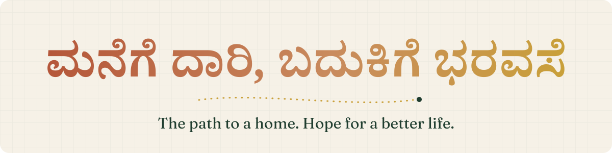

Mane Maarga helps case workers take rural families in Karnataka from their first housing-assistance record to their front door, keeping documents, money and construction stages in one record that anyone can check.


<p>


</p>

[Live preview](https://mane-maarga.vercel.app) · [Run it locally](#run-it-locally) · [Screenshots](#screenshots) · [Responsible AI](#responsible-ai)

</div>

---

## Live demo

- **Live preview:** open [mane-maarga.vercel.app](https://mane-maarga.vercel.app), choose **Access the platform**, then **Explore with sample data**. No server is needed: a clearly labelled demo mode runs the workspace in your browser with invented “(sample)” families, using the same rules as the API (money ladder, 30% cap, no double counting). Nothing leaves the browser tab.
- **Full stack:** to sign in against the real API with document text extraction, [run it locally](#run-it-locally).
- **What's real:** Karnataka's PMAY-G figures (Lok Sabha and PIB), the scheme rules (17 cited clauses), the taluks and villages. The families are invented, because real beneficiaries' records are private.
- **What to explore:** add a family → upload a land record → compare the extracted fields with the case → check the money ladder → open **Intelligence** and choose **Run the agent** to watch it plan, call tools and pass the citation guard.

<div align="center">
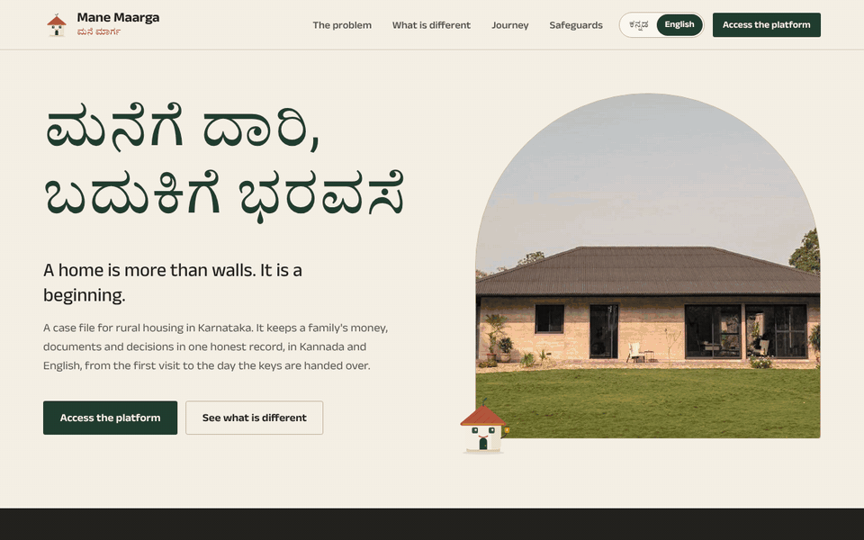
<br /><sub>Recorded from the running app. Karnataka figures, scheme rules and villages are real and cited; the families are invented to protect privacy.</sub>
</div>

## Why it exists

> Mane Maarga brings the housing-assistance journey into one transparent workflow, from identifying a beneficiary and verifying documents to financial planning, construction progress and completion.
>
> It's designed for rural accessibility and accountability. Administrators make better-informed decisions, and the family stays at the centre of the process.

**The problem, in public figures.** As on 7 Aug 2025, Karnataka had sanctioned 5,20,862 PMAY-G houses and completed 1,58,520 of them: **30.4%, against 73.4% across India**. That leaves **3,62,342 sanctioned houses not yet finished** ([Lok Sabha Q. 3722](https://eparlib.sansad.in/bitstream/123456789/2995468/1/AU3722_13vkmB.pdf)). A sanction is not a home.

<div align="center">
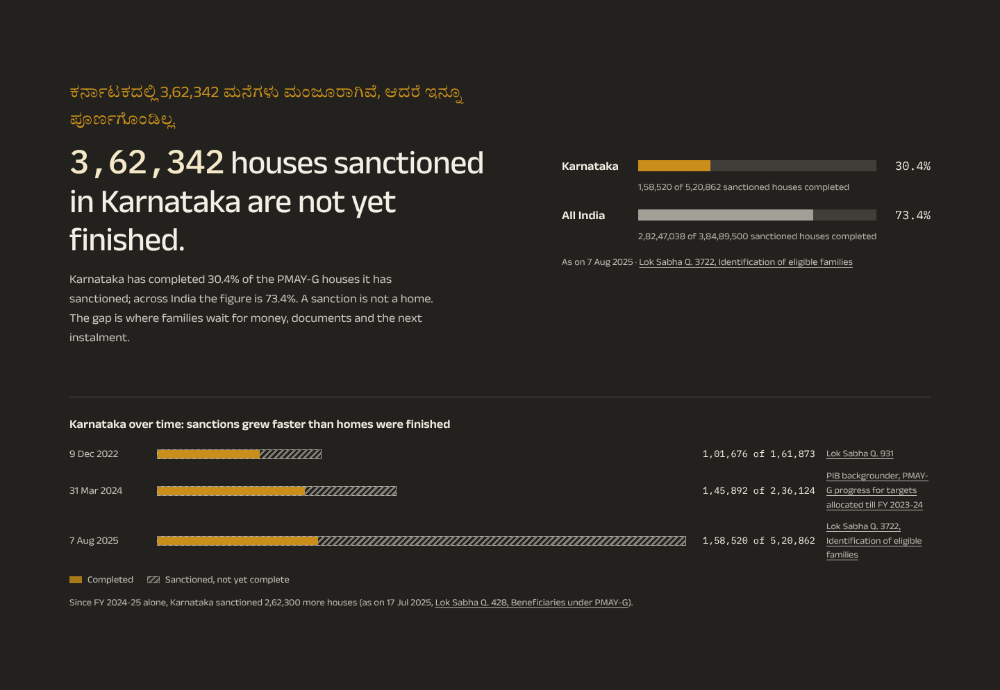
<br /><sub>From <code>backend/app/public_data/ka_pmayg_progress.json</code>: every figure links to the Lok Sabha answer or PIB document it came from, and derived numbers are computed in code.</sub>
</div>

Under PMAY-G, a family in the plains receives ₹1.20 lakh, released in instalments after each construction stage is verified. The bills come due before the instalment arrives, and that timing gap is where families stall. Mane Maarga shows the gap stage by stage. It keeps confirmed, proposed and estimated money separate, so none of it is counted twice.

Every rule and rupee comes from a dated, cited rule pack. [PROBLEM.md](PROBLEM.md) maps each part of the problem to its evidence, the feature that answers it, and where to see it.

## What only Mane Maarga does

| | What it does | Where to see it |
|---|---|---|
| **Money ladder** | Shows the cash a family must find before each instalment arrives, kept apart from the gap no scheme covers. | Financial planning |
| **Rules with receipts** | Every amount and eligibility rule has a clause ID, Kannada and English text, and its government source. Missing facts give "needs information", never a guess. | Every amount in the app |
| **The family says yes** | Payments, loans, submissions and document sharing wait for the family's one-time code, on a Kannada page that says what, how much and to whom. | Case file → Approvals |
| **No invented numbers** | The assistant picks tools; code does the arithmetic. An answer with a rupee figure it cannot trace is withheld. | Intelligence → Run the agent |
| **A Kannada voice** | Intake questions in everyday spoken Kannada, recorded in a warm voice; families can answer by talking. | Intelligence → Conversational intake |
| **Red-pen document checks** | Land records are compared with the case field by field; a reviewer decides on every mismatch. | Verification |

<div align="center">
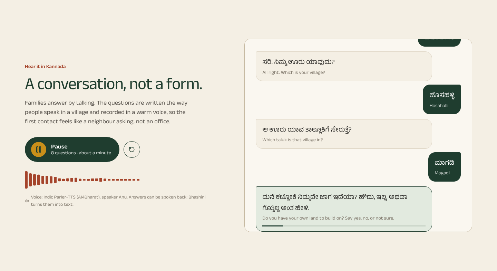
<br /><sub>On the landing page, the Kannada intake plays as a short conversation in the recorded voice.</sub>
</div>

## Screenshots

### Three pages, three answers

Each working page opens on the one sentence a field officer needs, with the figures behind it beside it.

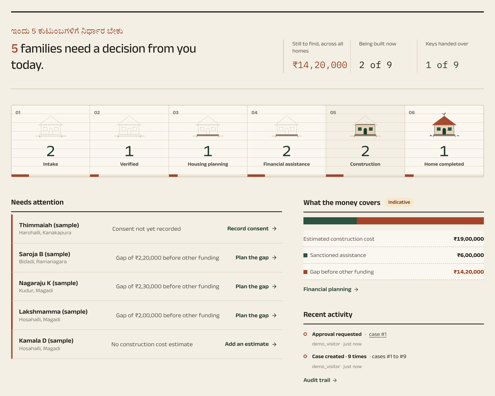
<sub><b>Overview.</b> Who needs a decision today, and the one thing to do for each.</sub>

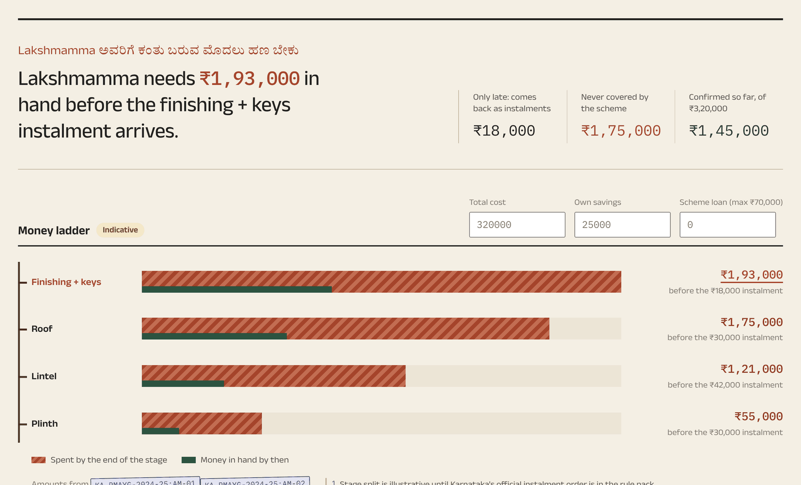
<sub><b>Financial planning.</b> The cash a family must find before each instalment, computed in code from cited rules.</sub>

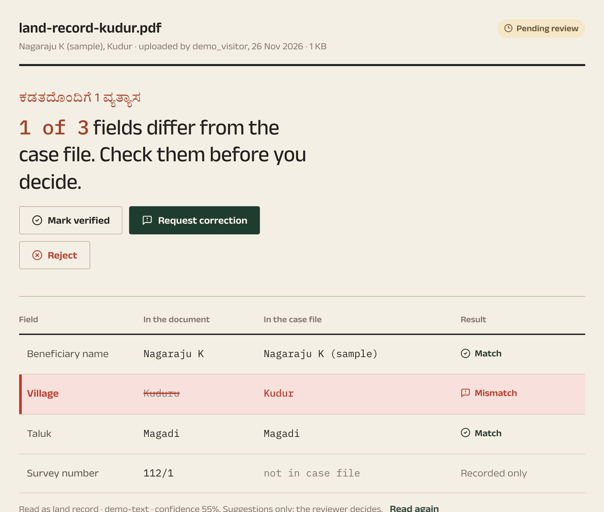
<sub><b>Verification.</b> The land record against the case file, field by field. A person decides.</sub>

### The family approves, on their own phone

<div align="center">
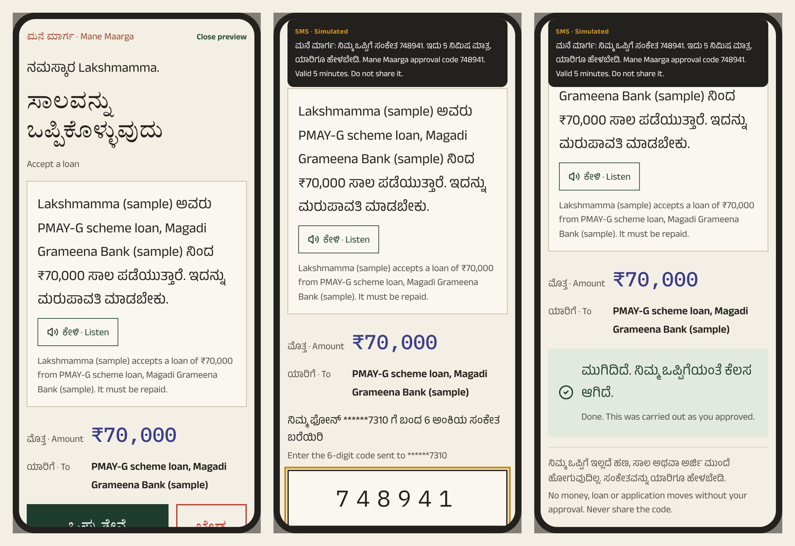
<br /><sub>Money, loans, submissions and document sharing wait for the family's one-time code. The page says in Kannada what will happen, how much, and to whom. In the demo the SMS is simulated and pops up on the phone.</sub>
</div>

### The agent, step by step

<div align="center">
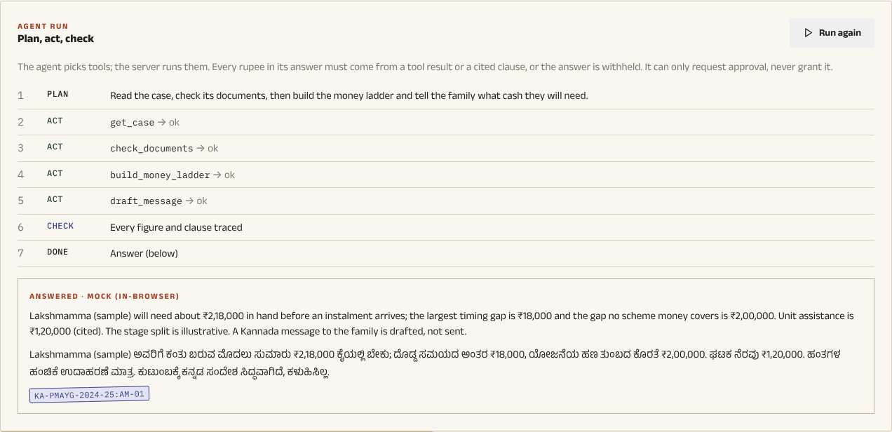
<br /><sub>Every rupee in the answer came from a tool result; the stamped clause ID links the ₹1,20,000 to its source. Try <code>make demo</code> for the recovery and blocked runs.</sub>
</div>

## What works today

| Area | What is built |
|---|---|
| **Beneficiary management** | Case records with village, taluk and phone (last four digits only), a six-stage journey, consent capture and withdrawal, search, filters and village grouping. |
| **Document verification** | PDF/PNG/JPEG upload (10 MB, file signatures checked), authenticated preview, text extraction with `pypdf` and Tesseract (English + Kannada), field-by-field comparison with the case, and a verify / reject / request-correction decision. |
| **Scheme-aware finance** | Funding sources marked proposed, confirmed, received or rejected. Duplicate confirmed scheme references are blocked. A dated PMAY-G Karnataka rule pack drives the **money ladder**, and a **30% repayment cap** counts every existing loan, including the PMAY-G scheme loan. |
| **Construction tracking** | A stage plan costed from the estimate, stage status, and photo evidence held for review. The house drawing fills in as stages are verified. |
| **Cited rules** | A dated Karnataka PMAY-G rule pack: 17 clauses, each with an ID, English and Kannada text, and its source (PIB, Lok Sabha, CAG). Eligibility and the 8 exclusion rules run in code; a missing fact gives *needs information*, never a guess. `make rules-lint` rejects any clause without a source or Kannada text. See [PROBLEM.md](PROBLEM.md). |
| **Agent runtime** | A PLAN → ACT → CHECK → RECOVER → ASK → DONE loop over 11 typed, audited tools. The model chooses; the server runs the tool. A citation guard withholds any answer whose figures or clauses can't be traced. Runs on a scripted mock with no key, or on Lyzr Agent Studio. |
| **Approval gate** | Six gated actions in a policy file. Agents and staff can only *request* them. Money, loans, submissions and sharing documents need the family's one-time code (stored as an HMAC, 5 minutes, 3 tries); a status change needs an administrator. One executor runs each approved action exactly once, after re-checking the payload hash. Document text reaches the model only as quoted data. |
| **Decision support** | Rule-based checks of documents, finance, construction and blockers, each with its evidence. Also: voice intake in Kannada, English and Telugu through Bhashini (speech recognition and natural Indian voices, female or male; audio never stored), scheme reference links, a budget estimate and follow-up tasks. |
| **Accountability** | JWT sessions with admin, operator and viewer roles, an audit trail of every sensitive action, rate-limited sign-in, and security headers with request IDs. |
| **Accessibility** | A full Kannada/English interface (self-hosted Anek and Tiro Kannada fonts, Kannada line height 1.7), a high-contrast sunlight mode, keyboard navigation and visible focus, status shown by icon and text (never colour alone), reduced-motion support, and phone layouts. |

## How a family moves through it

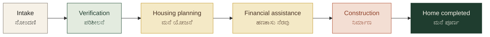

**Intake** records the household, with consent. **Verification** checks land and identity documents against the case. **Planning** settles the design and the estimate. **Financial assistance** keeps scheme money, savings, wages and loans apart. **Construction** tracks each stage with evidence. The case file won't move a family forward until consent is recorded, and every stage change is written to the audit trail.

## Architecture

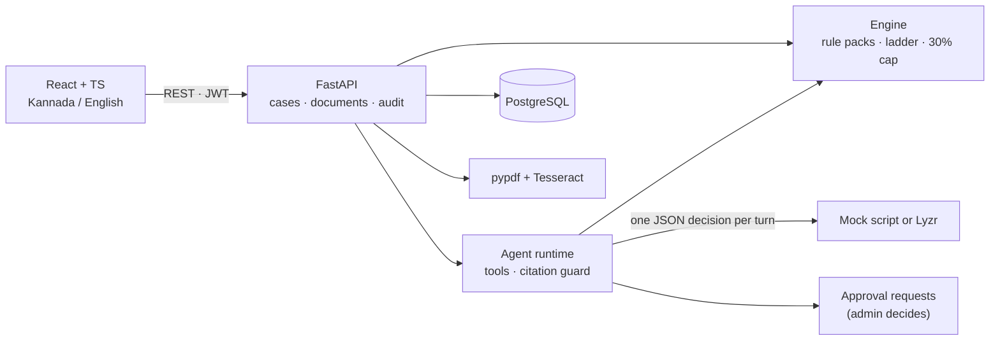

The engine (`backend/app/engine`) is pure Python with no I/O. It reads dated rule packs at `rules_data/<STATE>/<scheme>/<year>.json`, so a change in scheme rules is a data change with a source citation, not a code change. The model never computes money or eligibility: it picks a tool, the server runs it, and the guard checks the answer. Details: [ARCHITECTURE.md](ARCHITECTURE.md) and the [ADRs](docs/adr/).

## Benchmark: MaargaDocBench

An open, synthetic benchmark for the document checks. It generates Karnataka land records (RTC) and PMAY-G sanction orders with known ground truth and planted problems: OCR noise, missing fields, spelling variants of the same person or place, and true mismatches. It then runs the real extractor and case comparison from `backend/app/document_ai.py`. All names are invented, and the same seed always gives the same numbers.

```bash
python backend/benchmarks/maargadocbench_v0.py                         # 500 documents, seed 7
python backend/benchmarks/maargadocbench_v0.py --n 2000 --seed 1 --json results.json
python backend/benchmarks/maargadocbench_v0.py --via-pdf               # read every document back through pypdf first
```

**v0 results, 500 documents, seed 7:**

| Metric | Result | Target |
|---|---|---|
| Field F1 | **0.994** | ≥ 0.90 |
| Mismatch recall (true mismatches flagged) | **1.000** | ≥ 0.90 |
| Mismatch precision | 0.648 | — |
| Spelling-variant false-alarm rate | 1.000 (lower is better) | — |

What these numbers do and don't say:

- **It already caught a bug.** On the first run, the village field on every sanction order was read as "IN": the pattern matched "GRAM" inside the "GRAMIN" header. The fix took field F1 from 0.881 to 0.994, and a regression test now guards it.
- **Spelling variants are the weak spot.** Exact comparison flags *Kudur* vs *Kuduru* or *Lakshmamma* vs *Laxmamma* every time, which is why precision is 0.65. A Kannada-aware name matcher is the next component, and this metric is how its improvement will be measured.
- **These are clean, typed layouts.** Real scanned land records with Kannada script will score lower. The next version adds rendered and photographed scans, and Kannada-script fields.

## Responsible AI

Mane Maarga works with vulnerable families and public money, so the line between help and decision is part of the design:

- **People decide.** Agents can only create a pending approval request. Payments, loans, submissions and document sharing need the family's own one-time code, and status changes need an administrator. Tests prove that no tool changes status or money, that an agent trying to pay or submit is blocked and logged, and that an approved action runs exactly once.
- **Extraction is unverified until a reviewer confirms it.** Extracted fields are labelled as such, mismatches are flagged, and only a person can mark a document verified.
- **Money rules are transparent.** Proposed funding is never counted as confirmed. Existing loans are liabilities, not funding. The ladder's stage split is marked illustrative until it's checked against the PMAY-G guidelines.
- **Suggestions carry their evidence.** Each recommended action names the documents or figures behind it and the check that produced it.
- **The model explains; code decides.** With Lyzr connected, the model only chooses tools and writes the explanation. A citation guard withholds any answer with a figure not from a tool result or a clause that doesn't exist, and every run is stored step by step. Without keys, a labelled scripted mock runs instead.
- **Sensitive actions are auditable,** and consent can be withdrawn at any time.

## Security and privacy

| Implemented | Planned |
|---|---|
| JWT sessions (HMAC-SHA256, 60-minute expiry); PBKDF2-SHA256 password hashing | OTP sign-in for field workers |
| Admin, operator and viewer roles enforced on every route | Field-level access by district or taluk |
| Consent records with scope, version, who recorded it and when; withdrawal supported | A legally reviewed consent notice in Kannada |
| Uploads checked for extension, MIME type and file signature; random stored names; 10 MB limit | Encrypted object storage and malware scanning |
| Only the last four phone digits are stored; Extraction never stores Aadhaar numbers | Data-retention and deletion policy |
| Audit log of uploads, verifications, funding, stages, consent, users and analyses | Tamper-evident audit export |
| Secrets from environment variables; production refuses placeholder secrets and wildcard CORS; security headers; rate-limited sign-in | Independent security review |

> **Prototype status:** this has not had a production security review. Use synthetic records only.

## Run it locally

**You'll need:** Docker with Compose, and Git.

```bash
git clone https://github.com/SrijaMalhar/mane-maarga.git
cd mane-maarga
cp .env.example .env        # optional for local development; edit values before any deployment
docker compose up --build
```

| Service | URL |
|---|---|
| Web app | http://localhost:5173 |
| API | http://localhost:8000 |
| API docs (Swagger) | http://localhost:8000/docs |

On first launch, the app asks you to create the administrator account. To fill an **empty** workspace with synthetic families for a demo:

```bash
python3 scripts/seed_demo.py --username demo_admin --password 'choose-a-long-password'
```

Key settings in `.env` (see `.env.example`):

| Variable | Purpose |
|---|---|
| `MANE_MAARGA_JWT_SECRET` | Signs sessions. **Must** be a random string of at least 32 characters outside development. |
| `MANE_MAARGA_JWT_TTL_MINUTES` | Session length (default 60). |
| `CORS_ORIGINS` | The web app's origin(s), comma-separated. |
| `VITE_API_BASE_URL` | The API URL the frontend calls. |
| `MANE_MAARGA_BOOTSTRAP_ENABLED` | Allows first-administrator setup (off by default in production). |
| `MANE_MAARGA_AGENT_PROVIDER` | `mock` (default, no key) or `lyzr`. |
| `MANE_MAARGA_LYZR_API_KEY`, `MANE_MAARGA_LYZR_AGENT_ID` | Lyzr Agent Studio credentials, used only when the provider is `lyzr`. |
| `MANE_MAARGA_SERVICE_TOKEN` | Opens `/api/tools/*` to machine callers; unset keeps them closed. |
| `MANE_MAARGA_BHASHINI_USER_ID`, `MANE_MAARGA_BHASHINI_API_KEY` | Bhashini speech for Kannada voice intake. On Vercel, set `BHASHINI_USER_ID` and `BHASHINI_API_KEY` to turn it on in the live demo. See [docs/voice.md](docs/voice.md). |

To stop everything: `docker compose down`. Your database and uploads stay in Docker volumes. Removing them (`docker compose down -v`) **permanently deletes all records**.

**Tests:** `make test` (or `docker compose exec api python -m pytest -q`). There are 113 backend tests covering auth, roles, uploads, extraction, funding rules, the money ladder, affordability, every eligibility exclusion, every tool, the agent runtime, Bhashini speech and the approval gate (bypass, replay, tampering, expiry). CI also runs ruff, mypy, `rules-lint`, the benchmark, ESLint, a style lint (no hype words, emoji or gradients; every string in Kannada) and the frontend build on every push. `make demo` prints agent traces without any key.

Production Compose, operations and the release checklist are in [`docs/`](docs/).

## Project structure

```text
mane-maarga/
├── backend/
│   ├── app/
│   │   ├── main.py              # app factory (≈40 lines)
│   │   ├── api/                 # one router per area, incl. engine, tools, agent
│   │   ├── core/                # config, security, audit, observability
│   │   ├── engine/              # rule packs (cited, dated), eligibility, money ladder, affordability
│   │   ├── agents/              # tools, runtime, providers (mock, Lyzr), citation guard, prompts
│   │   └── document_ai.py       # text extraction and case comparison
│   ├── alembic/                 # migrations
│   ├── benchmarks/              # MaargaDocBench (synthetic document benchmark)
│   ├── scripts/                 # rules_lint.py, agent_demo.py
│   └── tests/                   # 113 tests
├── frontend/
│   ├── src/
│   │   ├── pages/               # Overview, Beneficiaries, CaseFile, Verification, Finance, …
│   │   ├── components/          # Mascot, drawings, Shell, ledger kit (LedgerTable, Stamp, RedPen, InkRung), agent trace
│   │   └── lib/                 # API client, i18n (Kannada/English), formatting
│   ├── public/images/mascot/    # mascot SVGs (exported from the React component)
│   └── scripts/                 # export-mascot, sync-rules, anti-ai-lint
├── scripts/                     # seed_demo.py, backup.sh
├── docs/                        # ADRs, deployment, operations, release checklist, README assets
├── PROBLEM.md                   # problem → evidence → feature → where to see it
├── ARCHITECTURE.md
├── docker-compose.yml
└── docker-compose.prod.yml
```

## Roadmap

- [x] Beneficiary case management with consent
- [x] Authentication, roles and audit trail
- [x] Document upload, extraction and human verification
- [x] Funding sources with double-count protection
- [x] Money ladder and 30% affordability cap from a dated PMAY-G rule pack
- [x] Construction stages with photo evidence
- [x] Kannada / English interface
- [ ] Replace the illustrative stage split with the official PMAY-G instalment schedule
- [x] Scheme eligibility and exclusion rules with clause-level citations (Kannada review pending)
- [x] MaargaDocBench v0: synthetic document benchmark with planted errors
- [ ] Kannada-aware name matcher (cut the variant false-alarm rate)
- [ ] Indic OCR for Kannada land records (beyond Tesseract)
- [x] Agent runtime with Lyzr provider, citation guard and server-side approval gate
- [x] Bhashini speech recognition and synthesis for voice intake, with a female or male voice
- [x] Expressive Kannada intake prompts (Indic Parler-TTS, voice: Anu)
- [ ] Re-record the intake prompts with a local speaker, such as an ASHA worker ([how](docs/voice.md))
- [x] In-browser demo mode for the hosted preview
- [ ] Hosted API for the live preview
- [ ] Frontend tests and monitoring

---

<div align="center">

**Every family deserves a safe place to call home.**
<br /><sub>ಪ್ರತಿಯೊಂದು ಕುಟುಂಬಕ್ಕೂ ಒಂದು ಸುರಕ್ಷಿತ ಮನೆ.</sub>

Mane Maarga — building pathways to dignified housing through technology, transparency and compassion.

[github.com/SrijaMalhar/mane-maarga](https://github.com/SrijaMalhar/mane-maarga) · MIT License

</div>
