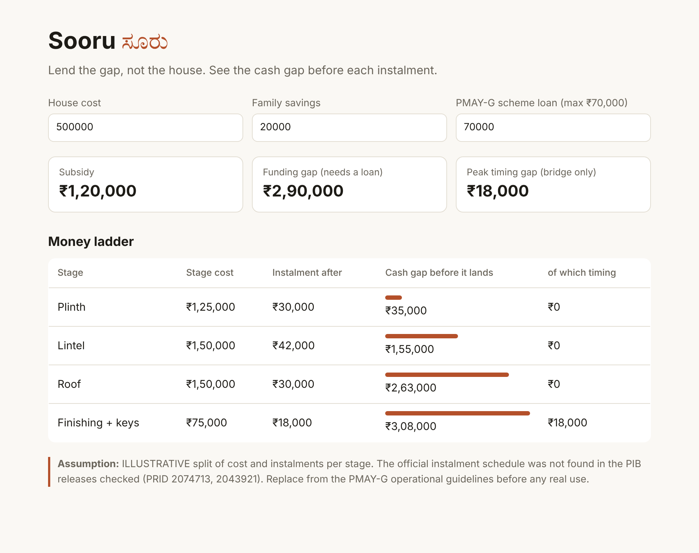
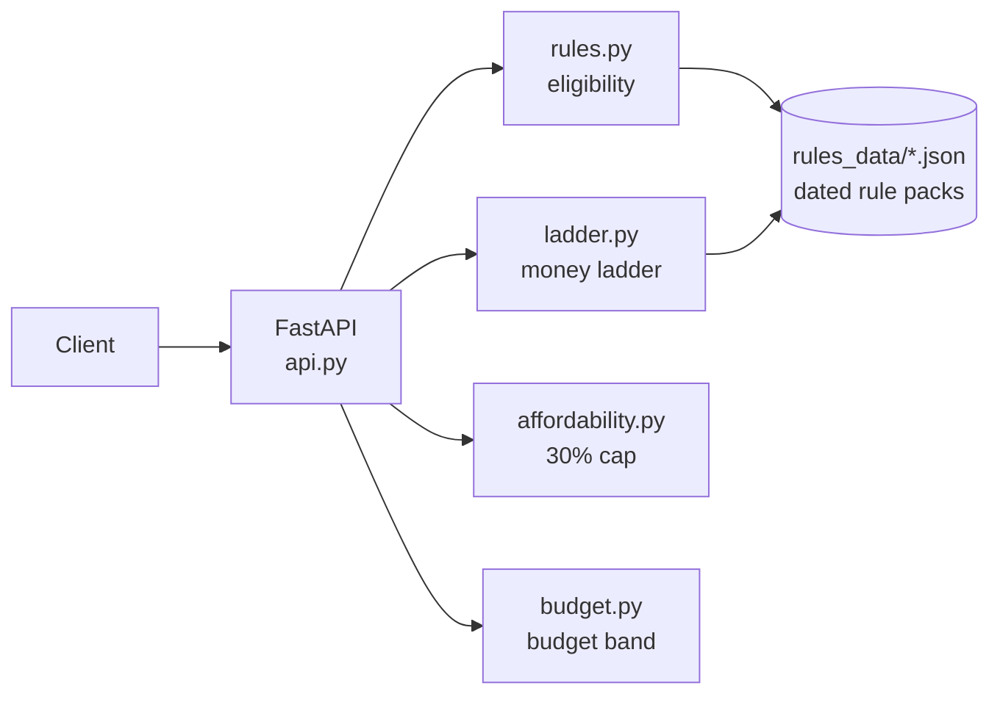

# Sooru (ಸೂರು, "roof")

**Lend the gap, not the house.** An AI case manager that takes a rural family from owned land to a finished home, and sizes the exact cash gap a co-operative bank needs to cover.

   <!-- [TODO: add a real CI build badge once a workflow exists] -->

Live demo: [TODO: demo URL]



The screenshot comes from the real engine output; the dev server for it was a throwaway script, not the FastAPI app.

## Overview

Rural families in India often own a plot and hold a housing-scheme sanction, yet the house stalls. The subsidy covers about ₹1.2 lakh of a ₹4.5–5.5 lakh house, and the next instalment only arrives after the next stage is built and verified. Sooru computes that gap rung by rung, checks what the family can safely repay, and keeps every rule traceable to a dated, cited rule file.

This repo is the **core engine** built for Tech4Bharat 2026 (Theme 1, Problem 1.1): rules-as-code eligibility, the money ladder, an affordability check, a budget band, a FastAPI layer, and a small React page for the money ladder. Voice, WhatsApp and document checks are not built yet (see [Roadmap](#roadmap)).

Headline result so far: 14 unit tests pass on the engine, including a test that locks the plan's operator-income arithmetic (about ₹3,000 per panchayat at a 5% share).

## Key Features

- **See the exact cash gap before each instalment.** The ladder shows, stage by stage, how much cash a family needs before the next subsidy payment lands.
- **Know which gap needs a loan.** The ladder splits a *timing gap* (cash needed until an instalment arrives) from a *funding gap* (cost the subsidy never covers), so only the second needs a term loan.
- **Never over-lend.** Total repayments across all loans, including the PMAY-G scheme loan, stay under 30% of monthly income, which is stricter than RBI's 50% microfinance cap.
- **Irregular income is handled honestly.** Affordability uses the average of the leanest three-quarters of months, so a good harvest month does not hide a bad wage month.
- **Eligibility answers cite their rule.** Every pass or fail returns the rule text and its citation. Missing facts come back as "need more information", never a guess.
- **Rules change by state and budget year without code changes.** Each rule pack is a JSON file with effective dates.

## Demo

[TODO: live link or GIF]. Sample output from the engine (₹5,00,000 house, ₹20,000 savings, ₹70,000 scheme loan):

<details>
<summary>Money ladder output</summary>

```json
{
  "total_cost": 500000,
  "subsidy": 120000,
  "own_savings": 20000,
  "scheme_loan": 70000,
  "funding_gap": 290000,
  "peak_timing_gap": 18000,
  "assumptions": ["ILLUSTRATIVE split of cost and instalments per stage. ..."],
  "rungs": [
    {"stage": "plinth", "cost": 125000, "instalment_after": 30000, "cash_gap_before_instalment": 35000,  "timing_gap": 0},
    {"stage": "lintel", "cost": 150000, "instalment_after": 42000, "cash_gap_before_instalment": 155000, "timing_gap": 0},
    {"stage": "roof",   "cost": 150000, "instalment_after": 30000, "cash_gap_before_instalment": 263000, "timing_gap": 0},
    {"stage": "finish", "cost": 75000,  "instalment_after": 18000, "cash_gap_before_instalment": 308000, "timing_gap": 18000}
  ]
}
```

Per-rung fields `label`, `cum_cost` and `cum_instalments` are trimmed here. The stage cost and instalment split is an illustrative assumption: the PIB releases I checked (PRID 2074713 and 2043921) give the ₹1.20 lakh unit assistance but no instalment schedule. Every ladder response carries this in `assumptions`.
</details>

## Tech Stack

| Layer | Tech | Why chosen |
|---|---|---|
| Core logic | Python 3 (plain modules) | Pure functions, so every rupee calculation is unit-testable without a server |
| API | FastAPI + Pydantic | Request validation and OpenAPI docs with little code |
| Rules | JSON rule packs with effective dates | Rules differ by state and budget year; changing them should not need a deploy |
| Tests | pytest | Fast, no setup |
| Frontend | React 18 + Vite | Live money ladder that recalculates as the inputs change |

## Architecture

Code owns every rule and rupee. The API only validates input and calls the core modules.



**Data flow:** a request arrives at `api.py`, Pydantic validates it, the matching module runs against the rule pack active today for that state, and the result returns as JSON. The `econ.py` module holds the unit-economics and operator-income checks and is not exposed over HTTP.

## Engineering Highlights

1. **Two gaps, not one.** A single "shortfall" number would push families into term loans for money that is only late. The ladder computes `gap_k = cumulative cost through stage k − (savings + loan + instalments received before k)`, then subtracts the funding gap to get the timing gap. Outcome: in the sample above, only ₹18,000 is a bridge need; ₹290,000 is the real funding gap. Tests cover both.
2. **The scheme loan counts toward the cap.** PMAY-G already offers a loan of up to ₹70,000. Affordability takes it as an existing loan, so the 30% cap holds across all debt. A test shows it shrinks the headroom for a new loan.
3. **Rules as dated data.** `load_pack` picks the pack whose `effective_from`/`effective_to` covers the date, and raises `LookupError` rather than falling back silently. Tests check dates before the first pack and unknown states.
4. **Plan claims become tests.** The jobs arithmetic from a plan review (122 houses per panchayat, about ₹61,000 at a 100% share, about ₹3,000 at 5%, 20 cases a month for ₹10,000) is asserted in `tests/test_core.py`, so a number cannot drift from the code.

## Performance and Results

| Check | Result | Method |
|---|---|---|
| Unit tests | 14 passed, 1 skipped | `pytest` in `backend/`; the skip is the API test when FastAPI is not installed |
| Test coverage | [TODO: measure with `pytest --cov`] | Not measured yet |
| API latency | [TODO] | Not measured yet |
| Eligibility/field accuracy on documents | [TODO] | Document benchmark not built yet |

No benchmark numbers are claimed beyond the tests above.

## Getting Started

**Prerequisites:** Python 3.11 or newer (tests run on 3.13). No database, no env vars, no API keys.

```bash
git clone https://github.com/SrijaMalhar/sooru.git
cd sooru/backend
python -m venv .venv
source .venv/bin/activate        # Windows: .venv\Scripts\activate
pip install -r requirements.txt
```

Run the tests:

```bash
python -m pytest -q
```

Run the API (port 8000):

```bash
uvicorn sooru.api:app --reload --port 8000
```

Open http://localhost:8000/docs for the interactive API docs.

Run the frontend (port 5173, needs Node 18 or newer). Keep the API running in another terminal:

```bash
cd ../frontend
npm install
npm run dev
```

Open http://localhost:5173. Vite forwards `/api/*` to the API on port 8000.

**Environment variables:** none are read today, so there is no `.env.example`.

## Usage

Money ladder:

```bash
curl -s -X POST http://localhost:8000/ladder \
  -H "Content-Type: application/json" \
  -d '{"total_cost": 500000, "own_savings": 20000, "scheme_loan": 70000}'
```

Returns the JSON shown in [Demo](#demo).

<details>
<summary>All endpoints</summary>

| Method | Path | Body | Returns |
|---|---|---|---|
| GET | `/health` | none | `{"status": "ok"}` |
| POST | `/eligibility` | `{"state": "KA", "facts": {"owns_land": true, "owns_pucca_house": false, "on_scheme_list": true}}` | verdict (`eligible`, `not_eligible`, `need_more_information`) with per-rule text and citation |
| POST | `/ladder` | `{"total_cost", "own_savings", "scheme_loan", "extra_grants"}` | gaps per stage, `funding_gap`, `peak_timing_gap` |
| POST | `/affordability` | `{"monthly_income": [12 values], "existing_loans": [{"name","principal","rate_pa","months"}], "requested", "rate_pa", "months"}` | income used, 30% cap, headroom, approved loan, `no_loan_path` |
| POST | `/budget` | `{"quotes": [at least 3 values]}` | `likely` and `high` budget |

An unknown state returns 404.
</details>

## Project Structure

```
sooru/
├── backend/
│   ├── sooru/
│   │   ├── api.py            # FastAPI routes (validation only)
│   │   ├── rules.py          # rule-pack loader, eligibility check
│   │   ├── ladder.py         # money ladder: timing gap vs funding gap
│   │   ├── affordability.py  # EMI maths, 30% cap, conservative income
│   │   ├── budget.py         # likely and high-side budget from quotes
│   │   ├── econ.py           # unit economics, operator-income check
│   │   └── rules_data/       # dated JSON rule packs (KA PMAY-G)
│   ├── tests/                # test_core.py, test_api.py
│   ├── pytest.ini
│   └── requirements.txt
├── frontend/                 # React + Vite money-ladder page
│   └── src/                  # App.jsx, api.js, styles.css
├── docs/
│   ├── Master_plan.docx      # full plan, scoring, pitch
│   └── images/               # README screenshot
└── LICENSE                   # MIT
```

## Testing

```bash
cd backend && python -m pytest -q
```

`tests/test_core.py` covers rule loading and effective dates, eligibility verdicts, the ladder (funding gap, timing gap, loan cap), EMI round-trip, the 30% cap with a scheme loan, the no-loan path, lean-month income, the budget band, the scheme-loan rate rule (lender base rate minus 3 points, no default), the unverified-stage-split flag, and the operator-income arithmetic. `tests/test_api.py` covers `/health`, `/ladder` and the 404 case; it skips itself if FastAPI or httpx is missing. [TODO: confirm `test_api.py` passes on your machine after `pip install -r requirements.txt`.]

## Deployment

[TODO: not deployed yet.] The API is a single ASGI app, so `uvicorn sooru.api:app --host 0.0.0.0 --port 8000` runs it on any host with Python.

## Roadmap

- [ ] Case store and approval gate: spoken yes plus OTP before any submission or payment
- [ ] Document mismatch check and a Kannada name matcher, with a published F1
- [ ] Replace the illustrative stage split with the official instalment schedule from the PMAY-G operational guidelines (not found in the PIB releases checked)
- [ ] Confirm the effective rate on the PMAY-G ₹70,000 loan with a bank. PIB says "3% reduced"; the code subtracts 3 points from a lender base rate you pass in and assumes no default
- [ ] Deploy and add a live demo link
- [ ] Confirm whether co-op banks can take bridge-credit repayment from a government transfer
- [ ] Frontend: eligibility, affordability and budget screens (only the money ladder exists)
- [ ] CI workflow, coverage report, API latency measurement
- [ ] Source links for the plan's big claims (see the Sources table in `docs/Master_plan.docx`)

## Contributing

[TODO: contribution policy.] Issues and pull requests are welcome. Run `python -m pytest -q` before opening one.

## License

MIT. See [LICENSE](LICENSE).

## Author

[TODO: full name] · GitHub: [SrijaMalhar](https://github.com/SrijaMalhar) · Email: srijamalhar@gmail.com · LinkedIn: [TODO] · Portfolio: [TODO]
