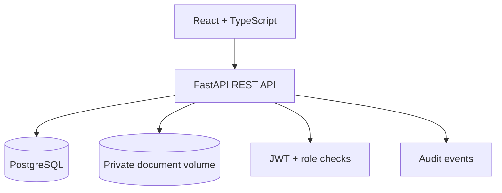

# Sooru — Housing Support Workspace

Sooru is a prototype workspace for tracking housing-assistance cases, consent, financing estimates, and supporting documents. This repository is a development prototype—not a production system and not a lending, credit, or government-scheme eligibility decision tool.

## Current implemented features

- React + TypeScript dashboard for beneficiary cases and pipeline status.
- FastAPI REST API with PostgreSQL (Docker) and SQLite support for tests.
- Case CRUD with validation and indicative financing-gap calculation.
- Consent record/history and withdrawal status.
- Audit events for case, consent, user, and document actions.
- First-run administrator bootstrap, username/password login, signed expiring JWT access tokens.
- Roles: `admin`, `operator`, and `viewer`.
- Admin user creation and listing.
- Authenticated document upload/download/listing for PDF, PNG, and JPEG; 10 MB maximum; extension/content-signature checks; pending/verified/rejected status.
- Uploaded files stored in a Docker named volume, not served as a public static directory.
- Frontend login/bootstrap, session token in `sessionStorage`, sign-out, role-aware controls, and document panel.
- Docker Compose health checks and persistent PostgreSQL/document volumes.
- Backend automated tests.

## Security and prototype limitations

- The first administrator can be bootstrapped only while the user table is empty. Do this only on a trusted local/dev environment.
- Set `SOORU_JWT_SECRET` to a unique random value before deployment. The Compose default is for local development only.
- Passwords use PBKDF2-HMAC-SHA256 with a per-user random salt.
- JWT tokens are signed with HS256 and expire after 60 minutes by default. There is no refresh-token or revocation mechanism yet.
- Uploads are restricted by extension, size, and basic file signature. Malware scanning, content sanitization, encrypted-at-rest storage, retention policies, and production object storage are not implemented.
- Rate limiting, account lockout, password reset, email verification, HTTPS configuration, CSRF review, security headers, and professional security testing remain required before deployment.
- Consent text is a demo placeholder and must be reviewed by legal/privacy experts and localized before real beneficiary data is processed.
- The finance estimate subtracts only sanctioned assistance from estimated construction cost. Existing loans are informational and are not deducted. Scheme eligibility, assistance disbursement, bridge-credit, affordability, and double-counting rules are not implemented or validated.

## Local setup

Prerequisites: Docker Desktop and Docker Compose.

1. Clone the repository.
2. (Optional but recommended for local development) Copy `.env.example` to `.env` and set a random `SOORU_JWT_SECRET`.
3. Run:
   ```bash
   docker compose up --build
   ```
4. Open:
   - Frontend: http://localhost:5173
   - API docs: http://localhost:8000/docs
   - Health: http://localhost:8000/health

On the first visit, create the administrator account. Use a password with at least 12 characters. Then sign in.

Stop the stack with `Ctrl+C`; use `docker compose down` to stop/remove containers. Persistent database and document volumes are retained. **Do not run `docker compose down -v` unless you intentionally want to delete local database and uploaded-document data.**

## API overview

### Authentication

- `GET /api/auth/status` — whether first-admin bootstrap is available.
- `POST /api/auth/bootstrap` — create the first admin only while no users exist.
- `POST /api/auth/login` — obtain JWT.
- `GET /api/auth/me` — current user.
- `GET /api/auth/users` — admin-only list.
- `POST /api/auth/users` — admin-only create user.

### Cases and consent

- `GET /api/cases` — authenticated.
- `POST /api/cases` — admin/operator.
- `GET /api/cases/{case_id}` — authenticated.
- `PATCH /api/cases/{case_id}` — admin/operator.
- `DELETE /api/cases/{case_id}` — admin only.
- `POST /api/cases/{case_id}/consent` — admin/operator.
- `GET /api/cases/{case_id}/consent` — authenticated.
- `GET /api/audit` — admin only.

### Documents

- `POST /api/cases/{case_id}/documents` — admin/operator; multipart field `file`.
- `GET /api/cases/{case_id}/documents` — authenticated.
- `GET /api/documents/{document_id}/download` — authenticated.
- `PATCH /api/documents/{document_id}/verification?status=pending|verified|rejected` — admin/operator.

## Backend tests

From `backend/`:

```bash
python -m pip install -r requirements-dev.txt
python -m pytest -q
```

Tests use a separate SQLite database and synthetic documents. They do not connect to the Docker PostgreSQL volume.

## Architecture



## Phase 7 — Sooru agent workflow prototype

`GET /api/cases/{case_id}/agent-plan` runs the case manager with deterministic specialist modules: document review, finance gap review, construction stage review, and recovery checklist. The endpoint reads current case records, document extraction statuses, funding records, and construction stages. It returns prioritized actions with evidence and a human approval gate.

This is intentionally **not connected to an external LLM or Lyzr yet**. It is a reliable workflow/orchestration prototype; deterministic Python owns calculations and permissions. It does not submit applications, approve loans, change case status, or release payments. Every suggested action requires operator review and beneficiary consent where applicable. Plan generation is audit logged.

Remaining production work: LLM/provider integration with grounded retrieval and citations; explicit consent and approval capture; versioned rules/state packs; Alembic migrations; authorization hardening, token revocation/throttling; voice channels; same-house image checks; affordability policy validation; encrypted document storage/retention; monitoring, backups, deployment, and security review.

## License

Choose and add a license before public distribution.

## Phase 5: scheme reference, funding ledger, construction-stage cash planning

- `GET /api/schemes`: reference catalog for PMAY-G, PMAY-U 2.0 BLC and Karnataka scheme names. It explicitly does **not** assess eligibility; current official rules/status must be checked.
- `POST /api/cases/{case_id}/funding`: record a funding source as proposed, confirmed, received, or rejected. Evidence documents must belong to the case. Duplicate confirmed/received scheme references are rejected.
- `GET /api/cases/{case_id}/funding`: list funding records.
- `POST /api/cases/{case_id}/stages`: create a construction stage with planned cost and dates.
- `GET /api/cases/{case_id}/stages`: list stages.
- `PATCH /api/stages/{stage_id}/status`: update stage state (`planned`, `in_progress`, `verified`, `completed`, `blocked`).
- `GET /api/cases/{case_id}/finance-summary`: separate proposed, confirmed, and received funding; compute the remaining funding gap and cumulative stage cash shortfall.

Finance safety rules: proposed sources are never counted as confirmed; existing household liabilities are displayed separately; no scheme eligibility or credit recommendation is generated. The legacy case-level `sanctioned_amount` is counted as confirmed only when no detailed confirmed/received sources exist, and the response warns that it needs reconciliation to avoid double counting. This is a prototype ledger—not a lender decision or a verified government integration.

Phase 5 backend tests: `PYTHONPATH=. pytest -q`.


## Phase 6 — SooruDoc AI (local OCR + field checks)

Uploaded PDF/image documents can be processed through `POST /api/documents/{document_id}/extract` (operator/admin). The service uses PDF text extraction first and falls back to Tesseract OCR for image/scanned documents. Extracted fields include beneficiary name, village, taluk, survey number, extent and document reference number when present. It compares extracted beneficiary/location fields with the case record and returns match/mismatch review flags. Results are persisted and can be retrieved with `GET /api/documents/{document_id}/extraction`. Send `{"force": true}` to reprocess.

**Important:** OCR/extraction is a prototype. Confidence is an uncalibrated estimate, extracted fields can be wrong, and no extraction result verifies a document or establishes eligibility. Human verification is required before filing, funding, or any decision. Raw OCR text is not persisted by this feature. Docker installs Tesseract English/Kannada and Poppler for scanned PDFs.

## Phase 7 API

- `GET /api/cases/{case_id}/agent-plan` — authenticated; returns a deterministic case-manager plan with specialist findings and priority actions. This endpoint only reads records and logs plan generation.

The frontend includes an Agent case plan action in each beneficiary row. Plans are labeled as a deterministic prototype, and the approval gate is visibly unapproved.

## Phase 8 — Sooru Intelligence (unified completion phase)

This unified phase combines the former roadmap Phases 8–13:

- **Voice-first intake:** authenticated intake sessions, Kannada/English prompt flow, text transcript API. Browser speech recognition can be used by the frontend when supported; audio is not uploaded or stored.
- **Scheme reference catalogue:** PMAY-G, PMAY-U 2.0 BLC, Basava Vasati and Ambedkar Nivas reference cards. These are reference-only and do not calculate eligibility or promise benefits.
- **Budget planner:** transparent square-foot estimate tiers, editable contingency, labor/material/other allocation, confirmed vs proposed funds and indicative funding gap. Not a credit or affordability decision.
- **Construction evidence:** image upload attached to a construction stage, status remains pending human review. No automated identity, stage-completion or fraud claim.
- **Recovery tasks:** case-linked follow-up task creation and status tracking.
- **Reliability lab:** deterministic synthetic safety smoke suite and stored runs. This is not a real-world model benchmark.

New endpoints are grouped under `/api/intelligence`, `/api/cases/{case_id}/budget-plan`, construction evidence, and recovery tasks. The frontend adds a **Sooru Intelligence** workspace with six tabs.

Prototype safeguards: no government submission, benefit eligibility determination, credit decision, payment, or construction verification is automated. Scheme details and estimate assumptions must be verified and localized before pilot deployment.
