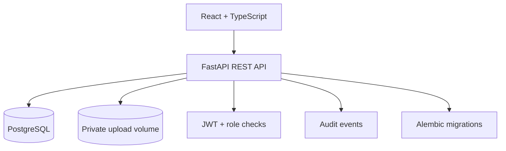

# Sooru — Housing Support Workspace

Sooru is a **prototype workspace** for tracking housing-assistance cases, consent, indicative financing plans, and supporting documents. It is not a lending, credit, government-scheme eligibility, payment, or construction-verification decision system.

## Features

- React + TypeScript case dashboard with role-aware workspace.
- FastAPI API, PostgreSQL (Compose), and SQLite test support.
- Case CRUD, consent history/withdrawal, audit trail.
- Admin bootstrap and PBKDF2 password hashes; expiring signed JWTs; admin/operator/viewer roles.
- Private authenticated document upload/download, content-signature checks, status review, OCR extraction and mismatch flags.
- Finance source ledger, construction stages, indicative budget plan and funding gap.
- Deterministic case-manager plan with specialist findings and explicit human approval gate.
- Voice-first text intake, scheme reference catalog, construction evidence, recovery tasks and synthetic safety smoke suite.
- Request IDs, security response headers, constrained CORS, database readiness check, login throttling baseline.
- Alembic migrations, Docker development/production configurations, CI workflow and operations docs.

## Safety and prototype boundaries

- No government application submission, eligibility determination, credit decision, payment, automated construction verification, or fraud detection is performed.
- Scheme cards are reference-only; verify current official rules and availability.
- Cost rates are indicative estimates and vary by location/design/market.
- OCR confidence is uncalibrated and extracted values require human verification.
- Browser speech input is optional; audio is not uploaded or stored.
- Documents are private within the app, but application-level malware scanning, encryption-at-rest, retention and production object storage are not implemented.
- Consent language is demo text. Have local privacy/legal experts review and localize before any pilot.
- In-memory login throttling and request metrics reset on restart and are not distributed controls.
- This is not ready for real beneficiary data without a security/privacy review and operational approval.

## Local development

Prerequisites: Docker Desktop and Docker Compose.

1. Copy `.env.example` to `.env` and use a strong local JWT secret.
2. Run `docker compose up --build`.
3. Open the frontend at `http://localhost:5173`; API docs at `http://localhost:8000/docs` (development only).
4. Bootstrap the first administrator on first run. Production bootstrap is disabled by default; enable it for the first administrator, then disable it.

The development Compose stack exposes PostgreSQL/API locally and persists database/uploads in named volumes. Stop with `Ctrl+C` or `docker compose down`. **Do not use `docker compose down -v` unless intentionally deleting data.**

## Tests

```bash
docker compose exec api python -m pytest -q
```

Or install backend development requirements in a Python 3.12 environment:

```bash
cd backend
python -m pip install -r requirements-dev.txt
python -m pytest -q
```

Frontend build:

```bash
cd frontend
npm install
npm run build
```

CI runs backend tests and frontend production build for pushes and pull requests to `main`.

## Production Compose

Production Compose is a deployment template, not a turnkey secure hosting environment. Configure a private `.env` from `.env.production.example` with production secrets and exact origins, then:

```bash
docker compose -f docker-compose.prod.yml up --build -d
```

The production frontend is served by Nginx; PostgreSQL and API are on an internal Compose network. Configure HTTPS termination, external monitoring, encrypted/off-host backups and upload-volume backup separately. See:

- `docs/DEPLOYMENT.md`
- `docs/OPERATIONS.md`
- `docs/RELEASE_CHECKLIST.md`
- `docs/DEMO.md`

## API health and diagnostics

- `GET /health` — liveness.
- `GET /ready` — database readiness.
- `GET /api/system/version` — service/version/environment.
- `GET /metrics` — in-process request counters (simple prototype endpoint; restrict network access).

## Architecture



## License

Choose and add a license before public distribution.
