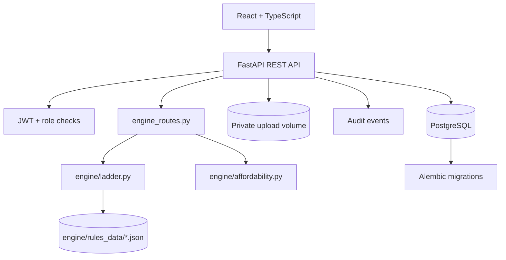

# Sooru (ಸೂರು, "roof") — Housing Support Workspace

**Lend the gap, not the house.** Sooru is a prototype workspace for tracking rural housing-assistance cases, consent, documents and indicative financing, built for Tech4Bharat 2026 (Theme 1, Problem 1.1). It is **not** a lending, credit, scheme-eligibility, payment or construction-verification decision system.

[](https://github.com/SrijaMalhar/sooru/actions/workflows/ci.yml) 

Live demo: [TODO: demo URL]


## Overview

A family can own a plot and hold a housing-scheme sanction, yet the house stalls: the subsidy covers a fraction of the cost, and each instalment arrives only after the next stage is built and verified. Sooru keeps one case per family, with consent, documents and funding sources, and computes the cash gap before each instalment so the right gap gets the right kind of money.

Headline: the money ladder splits every shortfall into a **timing gap** (cash needed only until an instalment lands) and a **funding gap** (cost the subsidy never covers), so only the second needs a term loan. In the sample below, ₹18,000 of a ₹3,08,000 peak cash gap is a bridge need and ₹2,90,000 is the funding gap.

## Features

**Case workspace**
- React + TypeScript dashboard, role-aware (admin, operator, viewer).
- Case CRUD, consent history and withdrawal, audit trail.
- Private authenticated document upload and download, content-signature checks, OCR extraction and mismatch flags.
- Funding-source ledger, construction stages, indicative budget plan and funding gap.
- Deterministic case-manager plan with specialist findings and an explicit human approval gate.
- Voice-first text intake (Kannada, English, Telugu), scheme reference catalogue, construction evidence, recovery tasks, synthetic safety smoke suite.

**Finance engine** (`backend/app/engine`)
- **Money ladder:** the exact cash gap before each instalment, split into timing gap and funding gap.
- **Affordability cap:** total repayments across all loans, including the PMAY-G scheme loan, stay under 30% of monthly income (RBI's microfinance cap is 50%). Income is the mean of the leanest three-quarters of months, so a good month does not hide a lean one.
- **Dated rule packs:** JSON per state and budget year with effective dates. A missing pack raises an error instead of falling back silently.

**Platform**
- PBKDF2 password hashes, expiring signed JWTs, constrained CORS, request IDs, security headers, login throttling baseline.
- Alembic migrations, Docker development and production configurations, CI, operations docs.

## Safety and prototype boundaries

- No government application submission, eligibility determination, credit decision, payment, automated construction verification or fraud detection is performed.
- Engine outputs are **indicative**. Every engine response carries a disclaimer, and the ladder lists its assumptions.
- The per-stage cost and instalment split in the rule pack is **illustrative**. The official instalment schedule was not found in the PIB releases checked (PRID 2074713 and 2043921); replace it from the PMAY-G operational guidelines before any real use.
- The PMAY-G loan (up to ₹70,000) is described by PIB as "at a 3% reduced interest rate". That is a 3-point reduction, not a rate, so the engine takes a lender base rate as input and assumes none.
- Eligibility rules exist in the rule pack for tests but are **not exposed over HTTP**; their citations still say VERIFY.
- Scheme cards are reference-only. OCR confidence is uncalibrated. Browser speech input is optional and audio is not stored.
- Not ready for real beneficiary data without a security and privacy review. Use synthetic data only.

## Tech stack

| Layer | Tech | Why |
|---|---|---|
| API | FastAPI, Pydantic | Validation and OpenAPI docs with little code |
| Data | PostgreSQL (Compose), SQLite (tests), SQLAlchemy, Alembic | Real database in deployment, fast tests |
| Finance engine | Plain Python modules | Pure functions: every rupee calculation is unit-testable without a server |
| Rules | JSON rule packs with effective dates | Rules differ by state and budget year; changing them should not need a deploy |
| Frontend | React 18, TypeScript, Vite | Typed UI; the ladder recalculates as inputs change |
| Ops | Docker Compose, Nginx, GitHub Actions | Same stack in dev, production template and CI |

## Architecture



The engine is stateless: a request is validated by Pydantic, the engine runs against the rule pack active today for that state, and the result returns as JSON. Engine routes sit behind the same JWT check as the rest of the API.

## Engineering highlights

1. **Two gaps, not one.** A single "shortfall" would push families into term loans for money that is only late. The ladder computes `gap_k = cumulative cost through stage k − (savings + loan + grants + instalments received before k)`, then subtracts the funding gap to get the timing gap.
2. **The scheme loan counts toward the cap.** Affordability treats the PMAY-G loan as an existing loan, so the 30% cap holds across all debt. A test shows it shrinks the headroom for a new loan.
3. **Rules as dated data.** `load_pack` picks the pack whose effective dates cover today, and tests cover dates before the first pack and unknown states.
4. **Unverified inputs are visible.** While the stage split is unverified, every ladder response includes an `assumptions` list and the UI shows it under the table.

## Getting started

Prerequisites: Docker Desktop and Docker Compose.

```bash
git clone https://github.com/SrijaMalhar/sooru.git
cd sooru
cp .env.example .env     # then set a strong SOORU_JWT_SECRET
docker compose up --build
```

- Frontend: http://localhost:5173
- API docs (development only): http://localhost:8000/docs
- Bootstrap the first administrator on first run. Production bootstrap is disabled by default.

The development stack persists the database and uploads in named volumes. **Do not run `docker compose down -v` unless you intend to delete data.**

## Using the money ladder

In the app, open **Sooru Intelligence → Money ladder**. Pick a case to fill the house cost, or enter amounts directly.

Over the API (all routes need `Authorization: Bearer <token>` from `/api/auth/login`):

```bash
curl -s -X POST http://localhost:8000/api/engine/ladder \
  -H "Authorization: Bearer $TOKEN" -H "Content-Type: application/json" \
  -d '{"total_cost": 500000, "own_savings": 20000, "scheme_loan": 70000}'
```

<details>
<summary>Sample response (trimmed)</summary>

```json
{
  "total_cost": 500000, "subsidy": 120000, "own_savings": 20000, "scheme_loan": 70000,
  "funding_gap": 290000, "peak_timing_gap": 18000,
  "assumptions": ["ILLUSTRATIVE split of cost and instalments per stage. ..."],
  "rungs": [
    {"stage": "plinth", "cost": 125000, "instalment_after": 30000, "cash_gap_before_instalment": 35000,  "timing_gap": 0},
    {"stage": "lintel", "cost": 150000, "instalment_after": 42000, "cash_gap_before_instalment": 155000, "timing_gap": 0},
    {"stage": "roof",   "cost": 150000, "instalment_after": 30000, "cash_gap_before_instalment": 263000, "timing_gap": 0},
    {"stage": "finish", "cost": 75000,  "instalment_after": 18000, "cash_gap_before_instalment": 308000, "timing_gap": 18000}
  ],
  "disclaimer": "Indicative calculation from illustrative assumptions. ..."
}
```
</details>

| Method | Path | Body | Returns |
|---|---|---|---|
| POST | `/api/engine/ladder` | `state` (default KA), `total_cost`, `own_savings`, `scheme_loan`, `extra_grants` | gaps per stage, `funding_gap`, `peak_timing_gap`, `assumptions` |
| POST | `/api/engine/affordability` | `monthly_income` (1 to 24 values), `existing_loans` (name, principal, rate_pa, months), `requested`, `rate_pa`, `months` | income used, 30% cap, headroom, `indicative_loan_within_cap`, `no_loan_path` |

An unknown state returns 404; out-of-range amounts return 422.

## Tests

```bash
cd backend
python -m pip install -r requirements-dev.txt   # Python 3.12
python -m pytest -q
```

- `tests/test_api.py`: the case workspace API (auth, cases, consent, documents, funding, stages, intelligence).
- `tests/test_engine.py`: rule-pack dates, ladder gaps and loan cap, EMI maths, the 30% cap with a scheme loan, the no-loan path, lean-month income, the scheme-loan rate rule, the unverified-assumption flag.
- `tests/test_engine_api.py`: authentication, validation, the 404 case and the affordability response shape.

Frontend build:

```bash
cd frontend && npm install && npm run build
```

CI runs the backend tests and the frontend production build on pushes and pull requests to `main`. Coverage and API latency are not measured yet.

## Project structure

```
sooru/
├── backend/
│   ├── app/
│   │   ├── main.py             # routes, auth, middleware
│   │   ├── engine_routes.py    # /api/engine/* (ladder, affordability)
│   │   ├── engine/             # ladder, affordability, rule packs
│   │   │   └── rules_data/     # dated JSON rule packs (KA PMAY-G)
│   │   ├── models.py, schemas.py, database.py
│   │   ├── document_ai.py      # OCR extraction and mismatch checks
│   │   └── agents.py           # deterministic case-manager plan
│   ├── alembic/                # migrations
│   └── tests/
├── frontend/src/               # App, AuthScreen, IntelligencePanel, MoneyLadderPanel
├── docs/                       # DEMO, DEPLOYMENT, OPERATIONS, RELEASE_CHECKLIST, images
├── docker-compose.yml          # development stack
├── docker-compose.prod.yml     # production template
└── .github/workflows/ci.yml
```

## Production

`docker-compose.prod.yml` is a deployment template, not a turnkey secure host. Configure a private `.env` with production secrets and exact origins, then `docker compose -f docker-compose.prod.yml up --build -d`. Set up HTTPS, monitoring and encrypted off-host backups separately. See `docs/DEPLOYMENT.md`, `docs/OPERATIONS.md` and `docs/RELEASE_CHECKLIST.md`.

Diagnostics: `GET /health`, `GET /ready`, `GET /api/system/version`, `GET /metrics` (restrict network access).

## Roadmap

- [ ] Replace the illustrative stage split with the official instalment schedule
- [ ] Confirm the effective PMAY-G loan rate with a bank
- [ ] Link the ladder to a case's own funding sources and stages instead of manual inputs
- [ ] Approval gate with OTP before any submission or payment
- [ ] Kannada name matcher and document benchmark with a published F1
- [ ] Confirm whether co-op banks can take bridge-credit repayment from a government transfer
- [ ] Deploy and add a live demo link; measure coverage and API latency

## Contributing

Issues and pull requests are welcome. Run `python -m pytest -q` in `backend/` and `npm run build` in `frontend/` first.

## License

MIT. See [LICENSE](LICENSE).

## Author

SrijaMalhar · GitHub: [SrijaMalhar](https://github.com/SrijaMalhar) · srijamalhar@gmail.com · LinkedIn: [TODO] · Portfolio: [TODO]
